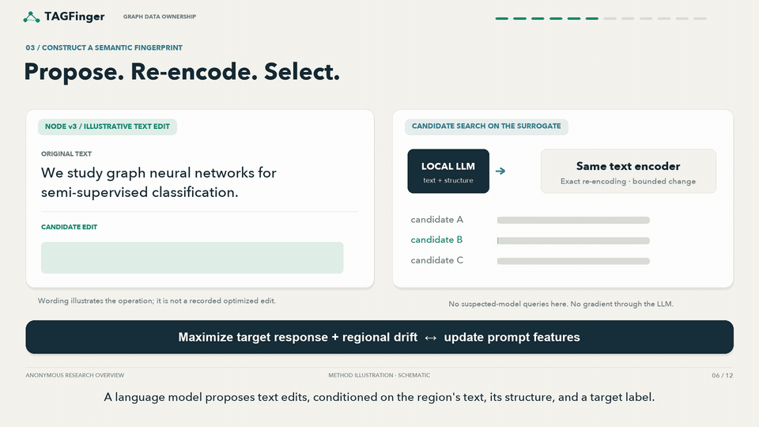

# TAGFinger

**TAGFinger: Semantic-Prompted Structural-Resilient Fingerprinting for Universal Ownership Verification of Text-Attribute Graphs**

TAGFinger is a **non-intrusive dataset ownership verification (DOV) framework** for **text-attribute graphs (TAGs)**.
Instead of relying on task-specific triggers, TAGFinger profiles fingerprints from the **inherent semantics and structures** of datasets, so that ownership can be verified across **diverse datasets, tasks, and GNN architectures** under fully black-box access (only classification probability vectors are observable).

This repository provides the official implementation of TAGFinger, including surrogate GNN alignment, LLM-based stable perturbation generation, and the universal verification protocol.

---

## 🔍 Motivation

Text-attribute graphs are expensive to collect and curate, yet they are increasingly reused without authorization.
Existing DOV methods typically:

- Depend on **task-specific triggers** tightly coupled to a single dataset and objective
- Fail under **multi-source training** (datasets mixed from different domains)
- Break when the **task or architecture changes**

TAGFinger addresses these limitations with semantic-prompted structural-resilient fingerprints that are:

- **Harmless**: no modification to the protected dataset
- **Universal**: effective across node-, edge-, and graph-level tasks
- **Robust**: stable under Prune, OD, RIGBD, and MAD attacks
- **Transferable**: consistent across GCN, GAT, GIN, and RGCN

---

## 🧠 Method Overview

TAGFinger consists of three main components:

1. **Sensitivity-Guided Adversarial Knowledge Alignment (SAKA)**
   - A generative adversarial graph (GAG) generator (2-layer MLP, hidden 256) actively exposes predictive discrepancies
   - A distribution-aware constrainer (DAC, KL divergence) and a deviation-aware constrainer (DVC, prediction deviations) align the surrogate GNN with the decision boundary of the black-box suspected model, at both node level and graph/subgraph level
2. **Prompt-Amplified Stable Perturbation (PASP) Construction**
   - Structurally resilient regions `V_i = {v_i} ∪ TopK_{u∈N(v_i)} S(u)` are identified via surrogate-based stability scores (top-k neighbors, k=2)
   - A fine-tuned **Qwen3-8B** with the paper's user prompt templates proposes candidate text edits conditioned on the region texts, the structural description, and the target label
   - Edited texts are re-encoded with the **same text encoder**; the perturbation is the encoding difference. Candidates are scored on the surrogate by `Σ_τ q_τ(y*) + λ·Δ_i` and the best is retained; prompt features are then updated by gradient ascent. The two steps alternate, no gradients pass through text generation, and the suspected model is never queried here
3. **Evidence-Aggregated Transferable Ownership Verification**
   - Task-unified prompts (TUP) reformulate node/edge/graph instances as graph/subgraph classification inputs (`Φ_τ`), each appended with a learnable prompt graph; predictions come from the queried model's **graph-level readout + task classifier** (not averaged node probabilities)
   - Tri-valued evidence `r_τ ∈ {1, 0, -1}` is aggregated with threshold `ϑ`: single-source uses `T'={node}, ϑ=1`; multi-source uses all three tasks with majority voting `ϑ=2`

<p align="center">
  
</p>

## 🎬 Video Overview

<p align="center">
  <a href="images/TAGFinger_Overview_v2.mp4">
    
  </a>
</p>

> Watch the new **3-minute 22-second narrated overview**: [`images/TAGFinger_Overview_v2.mp4`](images/TAGFinger_Overview_v2.mp4).
> Method animations and probability responses are explicitly schematic. Result panels cite specific settings from main-paper Tables 1, 3, and 4.
> [Local preview page](video/preview.html) · [Captions and editable video source](video/README.md).

---

## 📁 Repository Structure

```text
TAGFinger/
├── data/               # TAG loading (tag_data.py), mixing, splits, induced-graph utilities
├── evaluation/         # S@K metrics, reconstruction-loss analysis, baseline protocols
├── images/             # Schematics and demo materials
├── llm/                # Qwen3-8B perturbation generation, paper prompt templates, LoRA fine-tuning
├── model/              # GCN/GAT/GIN/RGCN backbones, graph heads, SAKA surrogate training
├── pretrain/           # Pre-training strategies (DGI, GraphCL, GraphMAE, SimGRACE, etc.)
├── prompt/             # Graph prompt implementations, including task-unified prompts (TUP)
├── tasker/             # Node-/edge-/graph-level task adaptation
├── utils/              # PASP utilities, attacks (Prune/OD/RIGBD/MAD), text encoder, metrics
├── clean_data..py      # TAG preparation: encode raw texts and save features/edges/labels/texts
├── ours.py             # Main entry (fingerprint construction and verification pipeline)
└── README.md
```

---

## 🚀 Quick Start

### Requirements

The dependency versions previously listed in the manuscript have not been
validated for this corrected implementation. Use a mutually compatible
PyTorch/CUDA/PyG stack for your actual device and a Transformers release that
supports Qwen3; do not treat this README as a recovered environment lockfile.

- Python 3.10+
- PyTorch, PyTorch Geometric, scikit-learn, numpy
- Transformers, accelerate (for model device placement)
- peft (for LoRA adapter loading/fine-tuning), datasets (for fine-tuning)
- torch-sparse is required only by backbones that use it (such as RGCN)

`python ours.py --help` and the dependency-free protocol tests do not require
PyTorch. The runner does not train anything on import. LoRA training uses
Transformers Trainer with an explicit Adam optimizer, and saves the tokenizer
beside the adapter. Generation recognizes PEFT adapter directories, uses the
requested device, and accepts only explicitly parsed node-text edits.

### 1. Prepare the TAG datasets

Evaluate on the five datasets of the paper: **Cora-ML, CiteSeer-ML, ArXiv-HepPh, ArXiv-CS, Reddit**.
Encode the raw texts with the dataset's encoder (Appendix E: GCN_LLMEmb for Cora-ML/CiteSeer-ML, ENGINE for the ArXiv datasets, TAPE for Reddit) and save the prepared files:

```bash
python clean_data..py --name Cora-ML --raw_file raw/cora_ml.jsonl \
    --text_encoder /path/to/encoder --out_root data/TAG
```

Each dataset directory contains `features.pt`, `edge_index.pt`, `labels.pt`, `texts.jsonl`, `split.pt`.
For mixed-dataset experiments, encode all sources with the **same** language model (13 classes for Cora-ML/CiteSeer-ML, 48 for Cora-ML/Reddit).

#### Original graph instances (required only for the graph task)

The graph task uses **whole source-provided graphs and their original graph
labels**, not k-hop subgraphs labeled by the majority node class. Node-only
TAG files do not establish a graph-classification task. Supply
`<data_root>/<dataset>/graph_instances.pt` from the original graph dataset:

```python
torch.save({
    "graph_index": original_graph_id_per_node.long(),  # shape [N]
    "labels": original_graph_labels.long(),            # shape [G]
    "num_classes": original_graph_class_count,          # int, >= 2
    "train_mask": original_graph_train_mask.bool(),    # shape [G]
    "val_mask": original_graph_val_mask.bool(),
    "test_mask": original_graph_test_mask.bool(),
}, "data/TAG/<dataset>/graph_instances.pt")
```

The feature/edge files must represent the disjoint union of these original
graphs in the same node order. Graph IDs are contiguous `0..G-1`; every graph
has nodes, edges cannot join different graphs, and the graph-level splits
must be disjoint and complete. `labels.pt` remains the **node** labels;
`graph_instances.pt["labels"]` defines a separate graph-class label space.
Do not invent graph boundaries or labels from connected components or node
majorities when the source dataset does not provide them.

Training samples complete graphs from the graph-level training split. SAKA
and fingerprint verification also query complete graph instances; PASP only
changes the selected node features within the graph. No graph cropping or
graph-label replacement occurs. Node-removal attacks retain the graph label
of each surviving instance. For graph-task mixtures, both sources need this
metadata, sampling retains whole graphs, and `--mix_ratio` specifies the
fraction of **graph instances selected from each source**, not a node-level
mixture ratio. The graph-class offset is separate from the node-class offset.
This mode must not be treated as a reproduction of node-sampled mixtures.

Without genuine graph-level data, use `--tasks node` or `--tasks node edge`.
Requesting the graph task without its metadata fails explicitly rather than
silently generating a proxy graph task.

### 2. Fine-tune the LLM generator (optional)

```bash
python llm/train_lora.py   # Qwen3-8B, 50 epochs, Adam lr 1e-5, weight decay 0.005
```

### 3. Fingerprint construction and ownership verification

```bash
python ours.py --dataset Cora-ML --model GCN --tasks node edge \
    --llm_path /path/to/finetuned-Qwen3-8B \
    --text_encoder /path/to/encoder
```

Pre-generated LLM edits can be reused via `--pert_cache edits.json` (`{node_id: {edited_node_id: text}}`).
Each cache entry may also be a list of candidate-edit dictionaries. Cached
texts are proposals, not ownership evidence: every audited model independently
scores them and optimizes its own prompts. Without additional candidates, a
one-proposal cache does not reproduce the full LLM candidate search.
For all three tasks, add `--tasks node edge graph` after preparing the original
graph metadata above. The default still requests all three tasks and therefore
requires that metadata. The node task is required for surrogate-based stable
region construction.

#### Text perturbations and budgets

`--delta_budget` bounds the Frobenius norm of the encoding change over one
stable region. A candidate is accepted only when its **exact text encoding**
is within this budget. Over-budget or zero-change candidates are rejected;
their embeddings are not clipped or interpolated. The encoder is checked
against the prepared clean features for the edited nodes. If all proposals
for a region are rejected, the run fails explicitly rather than silently
substituting a zero fingerprint. The selected raw edits are included in the
JSON report.

SAKA's `--x_budget` is a separate coordinate-wise feature bound.
`--edge_budget` bounds added COO edge entries, counting both directions.
Zero means no structural additions. Existing edges, duplicates, self-loops,
and cross-original-graph additions are filtered. Discrete topology selection
does not have an exact gradient; the bounded feature relay is a surrogate
gradient signal, not a proof of differentiable graph editing.

#### Explicit no-use controls and FPR reporting

No negative model is synthesized by shuffling protected features or rewiring
protected edges. For an FPR evaluation, supply genuinely separate prepared
training data, encoded with the same encoder and with the same task-label
semantics. Its directory must include `provenance.json`, for example:

```json
{
  "training_source_ids": ["independently-collected-source"],
  "label_space_id": "shared-topic-labels-v1"
}
```

```bash
python ours.py --dataset Cora-ML --tasks node edge \
    --llm_path /path/to/finetuned-Qwen3-8B --text_encoder /path/to/encoder \
    --independent_data_root /path/to/no-use-data \
    --independent_dataset Cora-ML --label_space_id shared-topic-labels-v1
```

The dataset option here selects the prepared folder/schema; the control's
declared training sources must exclude the protected sources. Original label
indices must match the audited task semantics, including the combined class
space for a mixed-source experiment. Same-directory, declared-source, and
exact normalized-text overlaps are rejected. These checks cannot establish
independence by themselves: provenance and data collection must still be
validated by the experimenter.

Both the positive and no-use models receive their own SAKA/PASP run on the
same protected query source, with the same configured seeds and budgets. No
positive-model fingerprint is merely transferred to the negative model.
Without supplied no-use data, the report includes positive evidence rates but
**FPR and S@K are unavailable**.

Metrics preserve the main text's tri-valued task decision. They report the
empirical per-fingerprint VSR/FPR at that **fixed rule**. S@1/S@5 are the VSR
only if that rule meets the respective observed FPR budget; otherwise the
result is `null`, not zero. There is no invented continuous ownership score,
no cross-node threshold, and no threshold tuned on the evaluation set. At a
fixed rule the two constrained values can coincide; the previously reported
table's differing values require the original calibration protocol and raw
results, neither of which are reconstructed by this code. Reports explicitly
set `paper_table_reproduction` to false. Per-fingerprint rates are not error
rates over independently trained models or statistical confidence bounds.

Early stopping uses disjoint train/validation centers and original graph
splits with task heads in evaluation mode. Message passing still uses graph
context (a transductive protocol); held-out node labels are not optimized in
the task losses. The node/edge task input construction is shared with SAKA,
including removal of the edge being predicted.
Task-unified SAKA queries only graph/subgraph posteriors, including the
node-centered task. Its local node classifier and node-task graph classifier
share decoder weights, allowing region probabilities to be derived on the
surrogate without requiring node-level outputs from the suspected model.
The standalone SAKA helper retains a legacy node-posterior mode only when no
task heads are supplied; that mode is not used by this runner.

### Key options (defaults follow Appendix D)

| Option | Default | Meaning |
|---|---|---|
| `--dataset` | `Cora-ML` | `{Cora-ML, CiteSeer-ML, ArXiv-HepPh, ArXiv-CS, Reddit}` |
| `--tasks` | `node edge graph` | Explicit task set; graph requires original graph metadata |
| `--model` / `--surrogate_model` | `GCN` | `{GCN, GAT, GIN, RGCN}` (RGCN = RobustGCN) |
| `--total_select` | `200` | Number m of fingerprint perturbations |
| `--topk_stable` | `2` | Neighbor count k; region size is at most k+1 |
| `--delta_budget` | `0.1` | Exact per-region text-encoding change budget |
| `--lam` | `0.5` | Trade-off coefficient λ of the drift term |
| `--theta` | strict majority | Evidence threshold ϑ; defaults to 2 for three tasks, 1 for node only |
| `--hidden` / `--num_layer` | `128` / `2` | GNN width / depth |
| `--saka_epochs` / `--patience` | `500` / `50` | SAKA epochs / early stopping |
| `--saka_lr` | `1e-3` | Surrogate learning rate |
| `--gen_hidden` | `256` | GAG generator hidden dimension |
| `--batch_node` / `--batch_graph` | `128` / `32` | Alignment / graph-task batch sizes |
| `--mix_dataset` / `--mix_ratio` | – / `0.8` | Mixed-dataset training (Tables 2–3) |
| `--attack` / `--attack_ratio` | `none` / `0.2` | `{prune, od, rigbd, mad}` robustness (RQ3) |
| `--no_dac` / `--no_dvc` / `--no_tup` | off | Module ablations (Table 5) |
| `--independent_data_root` / `--label_space_id` | – | Explicit no-use control and shared label semantics |
| `--recon_analysis` | off | Reconstruction-loss comparison (Fig. 6c,d) |

### Experiment recipes

```bash
# RQ2: single-source mixture (Cora-ML / CiteSeer-ML), 80%/20% ... 20%/80%
python ours.py --dataset Cora-ML --mix_dataset CiteSeer-ML --mix_ratio 0.8 ...
# RQ2: multi-source mixture (Cora-ML / Reddit)
python ours.py --dataset Cora-ML --mix_dataset Reddit --mix_ratio 0.2 ...
# RQ3: robustness under attacks (pruning swept up to 80%)
python ours.py --dataset Cora-ML --attack prune --attack_ratio 0.8 ...
# RQ4: cross-architecture transferability
python ours.py --dataset Reddit --surrogate_model GIN --model GAT ...
# RQ5: ablations
python ours.py --dataset Cora-ML --no_tup ...
```

Paper results are averaged over 5 runs with seeds `{0, 1, 2, 3, 4}` (`--seed`).
This command runs one seed and writes its decisions and configuration to a
JSON report. Aggregate independent runs explicitly; running it once does not
produce the paper's five-run means. The supplied OD/RIGBD/MAD sanitizers are
heuristic strategy implementations, not validated reproductions of the cited
defenses' original code.

Run graph-instance regression tests with `python -m unittest discover -s tests`.
Runtime tensor tests require PyTorch and PyTorch Geometric; missing dependencies
are reported as skipped tests, not successful runtime validation.

---

## 📊 Main Results

These are manuscript-reported results, **not results produced or validated by
the implementation corrections above**. No matching numbers are hardcoded.

- Verification accuracy **above 95.4%** across representative TAG datasets (node-level S@1)
- **Above 93.2%** accuracy under Prune / OD / RIGBD / MAD attacks
- **Above 93.5%** accuracy when transferring across popular GNN architectures

---

## 📄 License

This repository is released for research purposes only.
