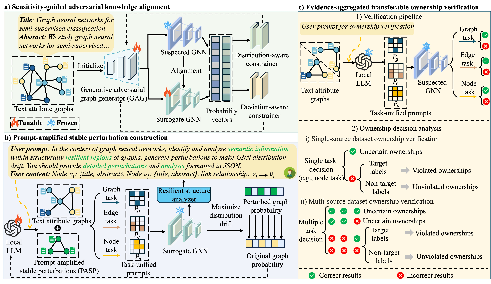
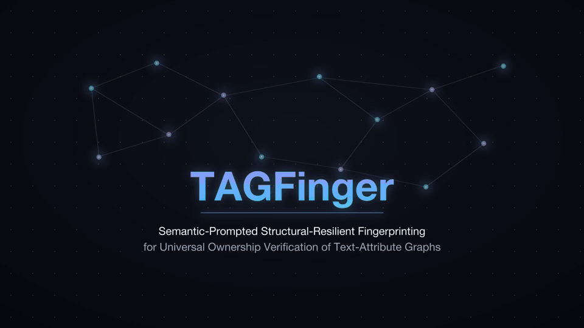

# TAGFinger

**TAGFinger: Semantic-Prompted Structural-Resilient Fingerprinting for Universal Ownership Verification of Text-Attribute Graphs**

TAGFinger is a **non-intrusive dataset ownership verification (DOV) framework** for **text-attribute graphs (TAGs)**.
Instead of relying on task-specific triggers, TAGFinger profiles fingerprints from the **inherent semantics and structures** of datasets, so that ownership can be verified across **diverse datasets, tasks, and GNN architectures** under fully black-box access (only classification probability vectors are observable).

This repository provides the official implementation of TAGFinger, including surrogate GNN alignment, LLM-based stable perturbation generation, and the universal verification protocol.

---

## 🔍 Motivation

Text-attribute graphs are expensive to collect and curate, yet they are increasingly reused without authorization.
Existing DOV methods typically:

- Depend on **task-specific triggers** tightly coupled to a single dataset and objective
- Fail under **multi-source training** (datasets mixed from different domains)
- Break when the **task or architecture changes**

TAGFinger addresses these limitations with semantic-prompted structural-resilient fingerprints that are:

- **Harmless**: no modification to the protected dataset
- **Universal**: effective across node-, edge-, and graph-level tasks
- **Robust**: stable under Prune, OD, RIGBD, and MAD attacks
- **Transferable**: consistent across GCN, GAT, GIN, and RGCN

---

## 🧠 Method Overview

TAGFinger consists of three main components:

1. **Sensitivity-Guided Adversarial Knowledge Alignment (SAKA)**
   - A generative adversarial graph (GAG) generator (2-layer MLP, hidden 256) actively exposes predictive discrepancies
   - A distribution-aware constrainer (DAC, KL divergence) and a deviation-aware constrainer (DVC, prediction deviations) align the surrogate GNN with the decision boundary of the black-box suspected model, at both node level and graph/subgraph level
2. **Prompt-Amplified Stable Perturbation (PASP) Construction**
   - Structurally resilient regions `V_i = {v_i} ∪ TopK_{u∈N(v_i)} S(u)` are identified via surrogate-based stability scores (top-k neighbors, k=2)
   - A fine-tuned **Qwen3-8B** with the paper's user prompt templates proposes candidate text edits conditioned on the region texts, the structural description, and the target label
   - Edited texts are re-encoded with the **same text encoder**; the perturbation is the encoding difference. Candidates are scored on the surrogate by `Σ_τ q_τ(y*) + λ·Δ_i` and the best is retained; prompt features are then updated by gradient ascent. The two steps alternate, no gradients pass through text generation, and the suspected model is never queried here
3. **Evidence-Aggregated Transferable Ownership Verification**
   - Task-unified prompts (TUP) reformulate node/edge/graph instances as graph/subgraph classification inputs (`Φ_τ`), each appended with a learnable prompt graph; predictions come from the queried model's **graph-level readout + task classifier** (not averaged node probabilities)
   - Tri-valued evidence `r_τ ∈ {1, 0, -1}` is aggregated with threshold `ϑ`: single-source uses `T'={node}, ϑ=1`; multi-source uses all three tasks with majority voting `ϑ=2`

<p align="center">
  
</p>

## 🎬 Video Overview

<p align="center">
  
</p>

> The full 3-minute narrated video is available at [`images/TAGFinger_Overview.mp4`](images/TAGFinger_Overview.mp4).

---

## 📁 Repository Structure

```text
TAGFinger/
├── data/               # TAG loading (tag_data.py), mixing, splits, induced-graph utilities
├── evaluation/         # S@K metrics, reconstruction-loss analysis, baseline protocols
├── images/             # Schematics and demo materials
├── llm/                # Qwen3-8B perturbation generation, paper prompt templates, LoRA fine-tuning
├── model/              # GCN/GAT/GIN/RGCN backbones, graph heads, SAKA surrogate training
├── pretrain/           # Pre-training strategies (DGI, GraphCL, GraphMAE, SimGRACE, etc.)
├── prompt/             # Graph prompt implementations, including task-unified prompts (TUP)
├── tasker/             # Node-/edge-/graph-level task adaptation
├── utils/              # PASP utilities, attacks (Prune/OD/RIGBD/MAD), text encoder, metrics
├── clean_data..py      # TAG preparation: encode raw texts and save features/edges/labels/texts
├── ours.py             # Main entry (fingerprint construction and verification pipeline)
└── README.md
```

---

## 🚀 Quick Start

### Requirements

The paper experiments use Python 3.10, PyTorch 2.1.0, PyTorch Geometric 2.4.0, Transformers 4.44.0, CUDA 12.1 (Ubuntu 22.04, NVIDIA 5090 32GB).

- Python 3.10+
- PyTorch 2.1.0, PyTorch Geometric 2.4.0 (+ torch-sparse)
- Transformers 4.44.0, scikit-learn, numpy
- peft / trl (only for LoRA fine-tuning in `llm/train_lora.py`)

### 1. Prepare the TAG datasets

Evaluate on the five datasets of the paper: **Cora-ML, CiteSeer-ML, ArXiv-HepPh, ArXiv-CS, Reddit**.
Encode the raw texts with the dataset's encoder (Appendix E: GCN_LLMEmb for Cora-ML/CiteSeer-ML, ENGINE for the ArXiv datasets, TAPE for Reddit) and save the prepared files:

```bash
python clean_data..py --name Cora-ML --raw_file raw/cora_ml.jsonl \
    --text_encoder /path/to/encoder --out_root data/TAG
```

Each dataset directory contains `features.pt`, `edge_index.pt`, `labels.pt`, `texts.jsonl`, `split.pt`.
For mixed-dataset experiments, encode all sources with the **same** language model (13 classes for Cora-ML/CiteSeer-ML, 48 for Cora-ML/Reddit).

### 2. Fine-tune the LLM generator (optional)

```bash
python llm/train_lora.py   # Qwen3-8B, 50 epochs, Adam lr 1e-5, weight decay 0.005
```

### 3. Fingerprint construction and ownership verification

```bash
python ours.py --dataset Cora-ML --model GCN \
    --llm_path /path/to/finetuned-Qwen3-8B \
    --text_encoder /path/to/encoder
```

Pre-generated LLM edits can be reused via `--pert_cache edits.json` (`{node_id: {edited_node_id: text}}`).

### Key options (defaults follow Appendix D)

| Option | Default | Meaning |
|---|---|---|
| `--dataset` | `Cora-ML` | `{Cora-ML, CiteSeer-ML, ArXiv-HepPh, ArXiv-CS, Reddit}` |
| `--model` / `--surrogate_model` | `GCN` | `{GCN, GAT, GIN, RGCN}` (RGCN = RobustGCN) |
| `--total_select` | `200` | Number m of fingerprint perturbations |
| `--topk_stable` | `2` | Stable region size k |
| `--lam` | `0.5` | Trade-off coefficient λ of the drift term |
| `--theta` | `2` | Multi-source majority-voting threshold ϑ |
| `--hidden` / `--num_layer` | `128` / `2` | GNN width / depth |
| `--saka_epochs` / `--patience` | `500` / `50` | SAKA epochs / early stopping |
| `--saka_lr` | `1e-3` | Surrogate learning rate |
| `--gen_hidden` | `256` | GAG generator hidden dimension |
| `--batch_node` / `--batch_graph` | `128` / `32` | Alignment / graph-task batch sizes |
| `--mix_dataset` / `--mix_ratio` | – / `0.8` | Mixed-dataset training (Tables 2–3) |
| `--attack` / `--attack_ratio` | `none` / `0.2` | `{prune, od, rigbd, mad}` robustness (RQ3) |
| `--no_dac` / `--no_dvc` / `--no_tup` | off | Module ablations (Table 5) |
| `--recon_analysis` | off | Reconstruction-loss comparison (Fig. 6c,d) |

### Experiment recipes

```bash
# RQ2: single-source mixture (Cora-ML / CiteSeer-ML), 80%/20% ... 20%/80%
python ours.py --dataset Cora-ML --mix_dataset CiteSeer-ML --mix_ratio 0.8 ...
# RQ2: multi-source mixture (Cora-ML / Reddit)
python ours.py --dataset Cora-ML --mix_dataset Reddit --mix_ratio 0.2 ...
# RQ3: robustness under attacks (pruning swept up to 80%)
python ours.py --dataset Cora-ML --attack prune --attack_ratio 0.8 ...
# RQ4: cross-architecture transferability
python ours.py --dataset Reddit --surrogate_model GIN --model GAT ...
# RQ5: ablations
python ours.py --dataset Cora-ML --no_tup ...
```

Paper results are averaged over 5 runs with seeds `{0, 1, 2, 3, 4}` (`--seed`).

---

## 📊 Main Results

- Verification accuracy **above 95.4%** across representative TAG datasets (node-level S@1)
- **Above 93.2%** accuracy under Prune / OD / RIGBD / MAD attacks
- **Above 93.5%** accuracy when transferring across popular GNN architectures

---

## 📄 License

This repository is released for research purposes only.